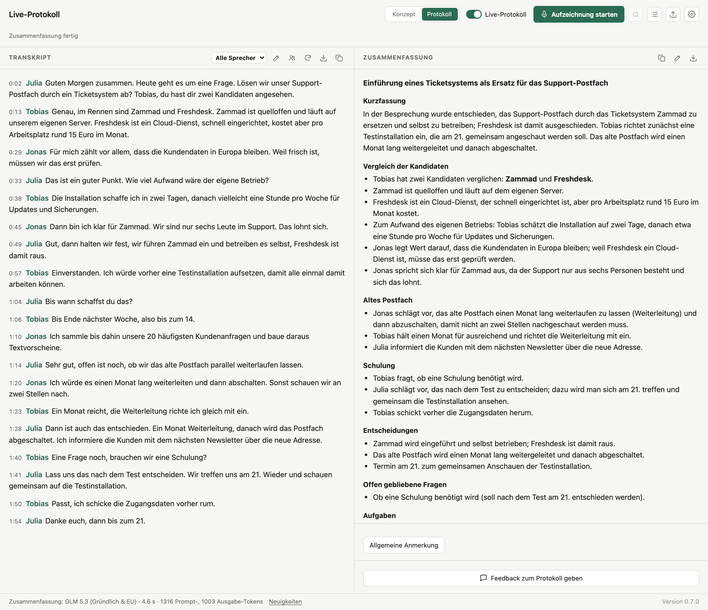
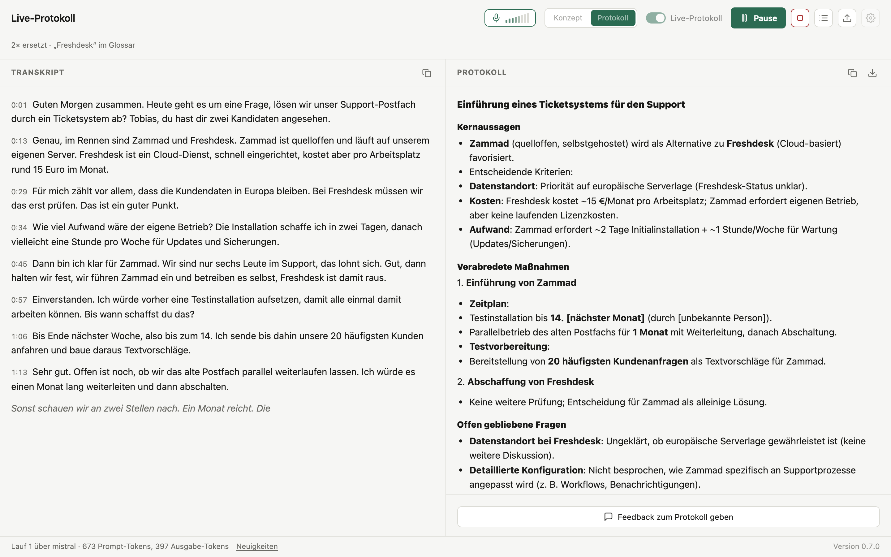
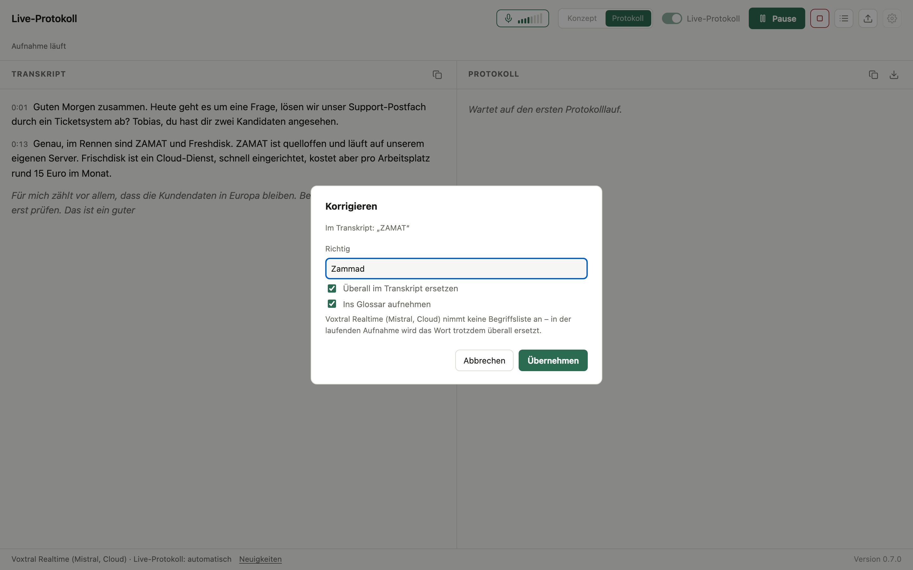
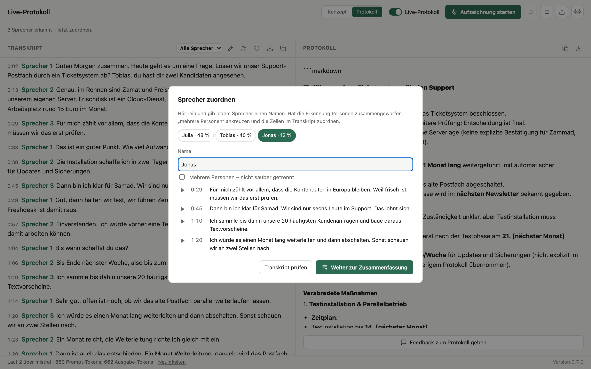
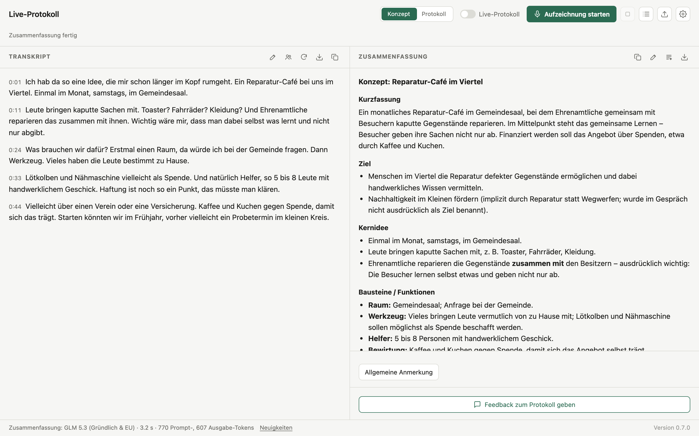
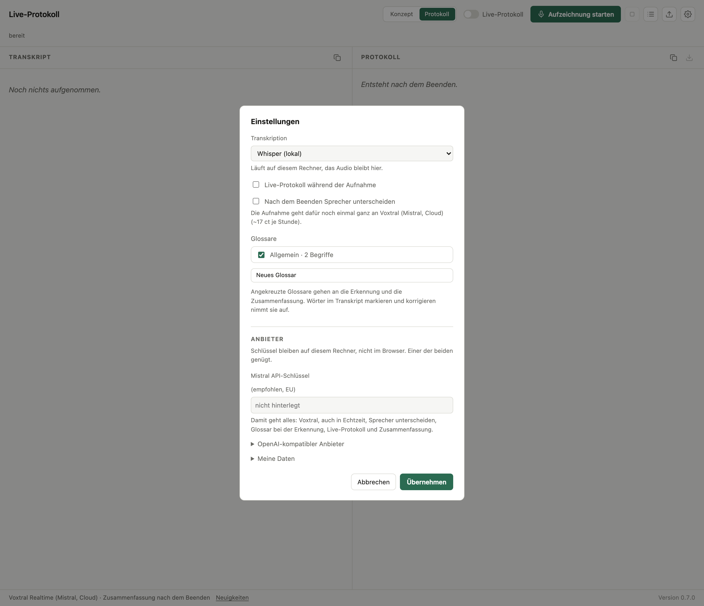

# Live-Protokoll

**Aufnahme starten, Besprechung führen, fertiges Protokoll mitnehmen.**

Live-Protokoll schreibt Besprechungen mit: links entsteht während der Aufnahme
das Transkript, rechts danach ein Protokoll mit Entscheidungen, Aufgaben und
offenen Fragen. Das Programm läuft auf dem eigenen Rechner, die Transkription
auf Wunsch komplett lokal mit Whisper. Für die Zusammenfassung genügt ein
Schlüssel für Mistral oder einen OpenAI-kompatiblen Dienst, oder ein lokales
Ollama.

[**Für Mac und Windows herunterladen**](https://github.com/nicohofdtz/live-protocol/releases)
· [Schnellstart](#schnellstart-desktop)
· [Auf einem Server betreiben](#schnellstart-server)



## Was es kann

**Mitschreiben, während gesprochen wird.** Das Transkript wächst live mit, auf
Wunsch schreibt sich auch das Protokoll schon während der Aufnahme fort. Eine
fertige Audiodatei lässt sich ebenso hochladen.



**Auch Online-Besprechungen.** Mit *Systemton mitschneiden* in den Einstellungen
nimmt die App neben dem Mikrofon auf, was der Rechner abspielt, etwa die
Gegenseite in Teams oder Zoom. Das läuft über die Bildschirmfreigabe von Chrome
oder Edge: Beim Start den Bildschirm wählen und „Systemton teilen“ einschalten,
das Bild wird nicht aufgezeichnet. Unter macOS braucht das Version 14.2, Chrome
oder Edge ab Version 141 und einmalig die Erlaubnis für die Bildschirmaufnahme;
Firefox und Safari liefern keinen Systemton.

**Verhörer einmal korrigieren.** Ein Wort markieren, richtig schreiben, fertig:
Die Korrektur gilt auf Wunsch überall im Transkript und auch für alles, was
danach noch gesagt wird. Sie landet im Glossar und hilft Erkennung und
Zusammenfassung beim nächsten Mal.



**Wissen, wer was gesagt hat.** Nach der Aufnahme unterscheidet die App die
Sprecher, du hörst kurz rein und vergibst Namen. Aufgaben im Protokoll tragen
dann die richtigen Personen. Das braucht einen Mistral-Schlüssel.



**Aus Gedanken ein Konzept machen.** Im Modus *Konzept aus Brainstorming*
sprichst du eine Idee einfach frei ein und bekommst ein strukturiertes Konzept
mit nächsten Schritten.



**Dazu:** Terminrahmen mit Agenda und Beteiligten, Anmerkungen und Feedback ans
Protokoll, mehrere Glossare, Export als Markdown oder Word und Projekte als
ZIP-Datei zum Weiterarbeiten.

**Du entscheidest, wohin deine Daten gehen.** Die Oberfläche sagt bei jedem
Cloud-Eintrag, was den Rechner verlässt und wie der Anbieter damit umgeht. Im
Betrieb mit Whisper und Ollama bleiben deine Inhalte auf deinem Rechner.



## Schnellstart: Desktop

1. Unter [Releases](https://github.com/nicohofdtz/live-protocol/releases) das
   Zip-Archiv für das eigene System laden (`macos-arm64` für Macs mit Apple
   Silicon, `windows-x64`) und entpacken.
2. Starten. Die Apps sind nicht signiert, das System fragt deshalb beim
   ersten Mal nach:
   - **macOS:** Einmal öffnen, die Warnung schließen, dann
     *Systemeinstellungen → Datenschutz & Sicherheit* öffnen, im Bereich
     *Sicherheit* den Knopf zum Öffnen der blockierten App (*Open Anyway*)
     klicken und mit dem Anmeldepasswort bestätigen. Der Knopf steht etwa
     eine Stunde nach dem Öffnungsversuch bereit; danach startet das Programm
     normal per Doppelklick.
   - **Windows:** Im Fenster „Der Computer wurde durch Windows geschützt“ auf
     *Weitere Informationen* und dann *Trotzdem ausführen* klicken. Ist unter
     Windows 11 die intelligente App-Steuerung (Smart App Control) aktiv,
     blockiert sie unsignierte Programme ohne diese Ausnahme.
3. Beim ersten Start lädt das Programm das Whisper-Modell nach (rund 570 MB).
4. Im Zahnrad als Transkription **„Whisper (lokal)“** wählen – das Audio
   bleibt dann auf dem Rechner – und unter *Anbieter* einen Schlüssel für die
   Zusammenfassung eintragen: einen **Mistral-Schlüssel** (empfohlen, EU,
   [console.mistral.ai](https://console.mistral.ai)) oder unter
   *OpenAI-kompatibler Anbieter* Vorlage, Adresse und Schlüssel, etwa für
   OpenRouter, OpenAI oder ein lokales Ollama.
5. Aufnahme starten.

Ohne Schlüssel verlassen Audio und Texte den Rechner nicht; transkribiert
wird trotzdem. Nach außen geht dann nur der Download des Whisper-Modells
beim ersten Start und die Update-Prüfung (abschaltbar mit
`UPDATE_CHECK=false`).

## Schnellstart: Server

```bash
cp .env.example .env      # MISTRAL_API_KEY oder einen OpenAI-kompatiblen Anbieter eintragen
docker compose up
```

Dann <http://localhost:8000> öffnen. Ohne weitere Einrichtung gibt es einen
einzigen Benutzer ohne Anmeldung – wer den Dienst offen ins Netz stellt,
schützt ihn davor. Für mehrere Benutzer übernimmt ein Proxy, der
`Remote-User` setzt (z. B. Authelia oder oauth2-proxy), die Anmeldung
(`AUTH_PROXY=true`). Lokale Transkription mit whisper.cpp im Container:
`docker compose --profile whisper up` und `WHISPER_URL=http://whisper:8081`.
Einzelheiten in [docs/server.md](docs/server.md).

**Von einem anderen Gerät aus braucht es HTTPS** (Reverse Proxy davor):
Browser geben das Mikrofon nur auf HTTPS-Seiten oder `localhost` frei.

Ohne Docker, etwa zum Entwickeln:

```bash
uv sync
cp .env.example .env
uv run uvicorn app.main:app --port 8000
```

Ohne `DEPLOYMENT_MODE` läuft das wie die Desktop-Fassung. Für die lokale
Transkription braucht es einen laufenden `whisper-server` (whisper.cpp) auf
Port 8081; `./start.sh` startet ihn zusammen mit der App, wenn er
installiert ist und das Modell unter `~/.local/share/whisper-models/` liegt.

## Konfiguration

Alles über Umgebungsvariablen bzw. die `.env`; `.env.example` erklärt jede
Einstellung. Die wichtigsten:

| Variable | Vorgabe | Wofür |
|---|---|---|
| `MISTRAL_API_KEY` | – | Mistral (empfohlen, EU): Voxtral, auch in Echtzeit, Sprecher, Glossar bei der Erkennung, Live-Protokoll, Zusammenfassung |
| `OPENAI_COMPAT_PRESET` | – | Vorlage für den OpenAI-kompatiblen Anbieter: `mistral`, `openrouter` (USA), `openai` (USA), `ollama` (lokal), `custom` |
| `OPENAI_COMPAT_BASE_URL`, `OPENAI_COMPAT_API_KEY` | aus der Vorlage | Adresse und Schlüssel des OpenAI-kompatiblen Anbieters |
| `OPENAI_COMPAT_LIVE_MODEL`, `…_SUMMARY_MODEL`, `…_TRANSCRIPTION_MODEL` | aus der Vorlage | Modelle für Live-Protokoll, Zusammenfassung und (optional) Transkription |
| `WHISPER_URL` | lokal `127.0.0.1:8081` | whisper.cpp-Server; auf dem Server nur mit dieser Angabe in der Auswahl |
| `DEPLOYMENT_MODE` | `desktop` | `hosted` für den Server-Betrieb (im Container gesetzt) |
| `AUTH_PROXY` | `false` | mehrere Benutzer hinter einem Proxy, der `Remote-User`/`Remote-Groups` setzt |
| `TRANSCRIPTION_ENGINES`, `LLM_ENDPOINTS`, `SUMMARY_MODELS` | aus den Anbietern | eigene Auswahllisten als JSON, für Sonderfälle |
| `DOWNLOAD_URL` | GitHub-Releases | Ziel des Hinweises auf die lokale Fassung |
| `UPDATE_CHECK`, `UPDATE_URL` | `true`, GitHub-API | Update-Prüfung der Desktop-Fassung |
| `OVERLAY_DIR` | – | eigene Seiten, Hinweisleiste, Logo – siehe [docs/overlay.md](docs/overlay.md) |
| `BANNER_TEXT` | – | Hinweisleiste oben als Klartext |
| `CONSENT_HINT` | `true` | vor jeder Aufnahme nach dem Einverständnis aller fragen |
| `MAX_SESSION_MINUTES` | 180 | längste Aufnahme im Server-Betrieb |
| `MAX_SESSIONS_PER_USER` | 2 | gleichzeitige Aufnahmen je Benutzer, nur mit `AUTH_PROXY` |
| `USAGE_LIMIT_USD` | aus | Monatsgrenze je Benutzer, nur mit `AUTH_PROXY` |
| `MAX_UPLOAD_MB` | 150 | größte hochgeladene Datei |

Mit nur einem Mistral-Schlüssel geht alles. Mit nur einem OpenAI-kompatiblen
Anbieter geht alles außer dem, was Mistral allein kann (Voxtral Realtime,
Sprecher unterscheiden, Glossar bei der Erkennung). Der alte
`OPENROUTER_API_KEY` gilt weiter als OpenAI-kompatibler Anbieter mit der
Vorlage `openrouter`.

Die Update-Prüfung fragt beim Start der Desktop-Fassung die GitHub-API nach
dem neuesten Release, im Backend und folgenlos, wenn nichts erreichbar ist.

Wie die Anwendung aufgebaut ist und was die einzelnen Funktionen tun, steht
in [docs/technik.md](docs/technik.md); Messungen und Modellvergleiche in
[experiments/BEFUNDE.md](experiments/BEFUNDE.md).

## Tests

```bash
uv run pytest -q
```

## Apps bauen

```bash
./build/build.sh          # macOS: baut whisper.cpp aus den Quellen, dann PyInstaller
```

Die Windows-Fassung entsteht in der CI (`.github/workflows/build.yml`). Ein
Tag `v*` baut beide Fassungen und hängt sie an einen Release-Entwurf, der von
Hand veröffentlicht wird. Versionen, Plattformen und Einzelheiten:
[docs/entwicklung.md](docs/entwicklung.md).

## Lizenz und Fremdbestandteile

MIT, siehe `LICENSE`. Fremdbestandteile und ihre Lizenzen stehen in
[THIRD_PARTY.md](THIRD_PARTY.md): `static/lame.min.js` ist lamejs 1.2.1
(LGPL-3.0), die Desktop-Apps enthalten whisper.cpp (MIT). Das
Whisper-Modell gehört nicht zum Repository; die Desktop-Fassung lädt es beim
ersten Start von Hugging Face.

Audio und Texte gehen nur an einen Cloud-Dienst, wenn ein Schlüssel
hinterlegt und der Dienst gewählt ist. Die Oberfläche sagt bei jedem
Cloud-Eintrag, was den Rechner verlässt. Unabhängig davon fragt die
Desktop-Fassung beim Start die GitHub-API nach einer neuen Version; dabei
gehen keine Inhalte mit.
